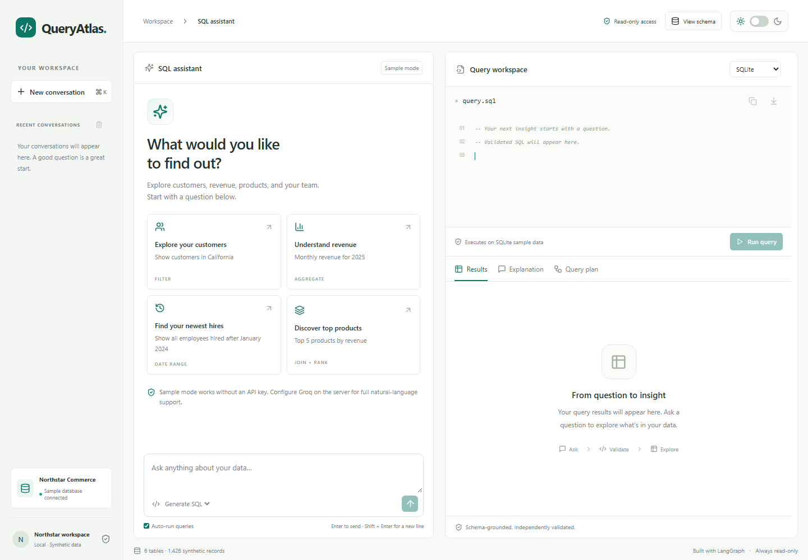

# QueryAtlas

A focused SQL assistant for a real synthetic commerce database. Ask a question, inspect validated SQL and its plain-English explanation, refine the query, run it read-only, and export results.

Implemented from the [project specifications](specs/README.md), with requirements and acceptance criteria defined before application code. [Product requirements](specs/01-requirements.md) describe the complete scope, and [amendments](specs/05-amendments.md) record approved changes. **GitHub and public Vercel publication are deferred at the user's request.** This repository is prepared for that later step.



## Run locally

Requirements: Python 3.12 and Node 20.17+ (Node 22 also supported). No database service or account is needed for sample mode.

PowerShell, from this directory:

```powershell
python -m venv .venv
.\.venv\Scripts\python.exe -m pip install -r requirements-dev.txt
npm ci
npm run build
.\.venv\Scripts\python.exe -m uvicorn api.index:app --host 127.0.0.1 --port 8000
```

Open **http://127.0.0.1:8000**. The one server serves both the built frontend and API. No login is required with the default configuration.

After initial setup/build, `npm start` launches this same local app using the project Python environment. Stop with Ctrl+C.

On macOS/Linux use `python3 -m venv .venv`, `.venv/bin/python -m pip install -r requirements-dev.txt` and `.venv/bin/python -m uvicorn api.index:app --host 127.0.0.1 --port 8000` instead. For frontend development, keep the backend on 8000 and run `npm run dev` in a second terminal; Vite proxies `/api` to it.

The committed `data/sample.db` is ready to use. To rebuild deterministic sample data:

```powershell
.\.venv\Scripts\python.exe scripts/seed.py
```

Restart the backend after rebuilding because immutable database connections/schema caches assume a fixed deployment asset.

## Live AI or keyless sample mode

Without a key, the app prominently says **Sample mode**. It runs deterministic examples through the same real LangGraph, SQL validator and database executor. It does not pretend to be an LLM.

Supported examples:

- `Show all customers` → `Only those from California` → `Sort by name` → `Only the first 10`.
- `Show customers in California`.
- `Show all employees hired after January 2024` (inclusive 2024-01-01, as defined in the SQL generation specification).
- `Monthly revenue for 2025` and `Top 5 products by revenue`.
- `How many customers` and counts of other named tables.
- Pasted read-only SELECT queries, optimization, and clear unique table/column typo corrections in Debug mode.

Other sample requests ask for clarification/configuration rather than returning unrelated template SQL. Full arbitrary schema-bound natural-language generation needs a live provider:

1. If `.env` does not exist, create it from `.env.example`; otherwise edit your existing `.env` without replacing its values.
2. Set `GROQ_API_KEY` on the **server** and optionally `GROQ_MODEL` (default `openai/gpt-oss-120b`). Obtain your own key through [Groq](https://console.groq.com/keys).
3. Restart the backend. `/api/health` and the UI show the actual configured mode/model.

Model configuration is exclusively server-side. There is no Settings & help page, browser credential field, or browser token storage. Add the following to the project's ignored `.env` file, then restart with `npm start`:

```dotenv
GROQ_API_KEY=your_groq_api_key
GROQ_MODEL=openai/gpt-oss-120b
```

Never put a provider key in frontend code, a `VITE_` variable, Git or chat. There is no silent sample fallback after a configured provider fails.

Recommended starting model: **GPT-OSS 120B on Groq**, available in Groq's rate-limited [free plan](https://console.groq.com/docs/rate-limits) and supporting [JSON output](https://console.groq.com/docs/structured-outputs). This is a practical recommendation for this app, not a measured SQL benchmark result. Exact limits/access depend on your Groq organization. The earlier Llama 3.3 70B default is now listed as enterprise access in Groq's catalog, so it is no longer the free-plan default. GPT-OSS uses low reasoning effort in this app; `GROQ_MODEL` remains configurable.

**Verification boundary:** local/sample paths and mocked provider integration are tested. A real Groq request has not been verified without a key.

After configuring a real key, run `.\.venv\Scripts\python.exe -m scripts.verify_live` to perform the opt-in live-provider smoke checks. It exits explicitly without claiming success when no key is set.

## Features and semantics

Real Python LangGraph routes intent, scope, schema, generation, validation, one bounded repair, safe optimization, optional execution and explanation. [Workflow and prompts](docs/workflow.md) explain each node. The UI includes chat/history, SQL highlighting, validation checks, explanation, actual results, query plans, dark mode, streamed graph progress/validated explanation, copy, SQL download and CSV export.

The simplified UI opens directly into the chat/query panels and uses SQLite; there is no introductory banner, dialect selector or inactive sidebar assistant card. Backend/API output dialects remain SQLite, PostgreSQL and MySQL. **All sample execution uses SQLite**, with strict SQLGlot translation of accepted PostgreSQL/MySQL API output. This is not native PostgreSQL/MySQL execution; unsupported translations fail. Collations, timezone behavior and vendor extensions may differ. Cost estimates use real SQLite EXPLAIN with a coarse relative-work heuristic, never money or native PostgreSQL/MySQL planner costs.

Revenue is historical `quantity × unit_price` from non-cancelled orders, including processing orders unless the user requests completed only. Data covers 2023–2025; examples explicitly use 2025. Dates are ISO text and money is synthetic USD using REAL for a demo, not production accounting. [Schema and data dictionary](docs/database.md) describe the six tables and foreign keys.

Conversations/theme live in this browser, capped and bounded; no multi-device sync or shared process memory. Delete individual conversations or use the confirmed clear-all action next to Recent conversations. SQL context is revalidated server-side and carries source dialect metadata. Model requests send bounded recent conversation to Groq only when configured.

## Validation and execution

The server independently parses a single SELECT/nonrecursive CTE, verifies actual tables/columns/scoped aliases, requires declared FK joins, allowlists functions, denies nested writes/system/file/network operations, strictly translates and compiles with SQLite. Generated, repaired and optimized queries all pass validation before returning. `/api/execute` repeats validation even for client-supplied SQL. [Security details](docs/security.md).

Execution opens bundled SQLite with `mode=ro&immutable=1`, applies an authorizer and a 2-second/1-million-VM-step budget, and returns at most 500 rows with explicit truncation. CSV exports displayed rows and neutralizes spreadsheet formula strings. Optimization removes only proven unused many-to-one LEFT JOINs, retaining joins that can change row counts. Indexes are suggestions in prose; none are created at runtime.

Limits: 4,000-char message; 12,000-char SQL; 16 context turns/24,000 chars; 128 KiB request; AST 600 nodes/40 levels. Complex derived joins and unsafe/unsupported functions may be conservatively rejected. This synthetic-data demo implements the boundaries in the [validation and guardrail specification](specs/10-sql-validation-and-guardrails.md). Before eventual public paid-model hosting, configure provider spend controls and shared/distributed hosting rate controls; no process-local counter is claimed to be a global limiter.

## Tests and demo

```powershell
.\.venv\Scripts\python.exe -m pytest -q
npm run build
npx playwright install chromium
npm run test:e2e
```

Browser tests start an isolated sample-mode API/frontend on port 8001, leaving your local app and `.env` provider configuration untouched. [Verification report](docs/verification.md) records actual outcomes and limits. Dependency closure is pinned in `requirements*.lock`, `package-lock.json`. The runtime `requirements.txt` is a self-contained copy of the exact runtime pins for Vercel compatibility; `scripts/lock_dependencies.py` regenerates it together with the Python locks after an intentional dependency upgrade. Keep both runtime files synchronized rather than adding a nested include to `requirements.txt`.

[Actual captioned demo video](artifacts/queryatlas-demo.webm) · [Transcript](artifacts/demo-transcript.md). To record again, start the built app on 8000 and run `npm run demo`. This records real interactions; allow 3–5 minutes. Large recordings are ignored by Git; publish the file separately when an upload destination is authorized.

## Docker

```sh
docker compose up --build
# or
docker build -t queryatlas .
docker run --rm -p 127.0.0.1:8000:8000 --env-file .env queryatlas
```

Open port 8000. The multi-stage image builds React, installs pinned runtime dependencies and runs Python as a non-root user. Compose uses a read-only filesystem. No database volume is necessary. Container execution is only marked verified if a Docker daemon was available; see verification report.

## Vercel (prepared, publication deferred)

Follow the [project-specific Vercel deployment guide](docs/vercel-deployment.md) for repository import, exact build settings, server secrets and production checks.

`vercel.json` selects Vite, builds `dist`, routes `/api` to the Python ASGI function and bundles backend/prompts/sample.db. `.python-version` requests Python 3.12. No remote database provision is needed: the immutable SQLite file ships inside the function. Do not use a writable local SQLite file for persistent serverless data.

When you authorize publication: push to your chosen GitHub repo, import the project into Vercel, keep the checked-in configuration, set server secrets, deploy and deliberately disable deployment protection for the reviewer URL if required. Verify unauthenticated root/schema/chat/SSE/execution on a cold deployment. Then add real GitHub/public app URLs to [submission.md](docs/submission.md). No account resources were created or pushed during local implementation. Hosting behavior has not been verified by an actual Vercel deployment.

## Deliverable map and assumptions

All six local deliverables are included. [Deliverable audit](docs/deliverables.md) records the artifacts and validation evidence.

| Deliverable | Included artifacts |
| --- | --- |
| Complete source code | [Frontend](src/), [API](api/index.py), [backend](backend/), [scripts](scripts/), [tests](tests/) and dependency/configuration files |
| Setup instructions | This README: local setup, environment configuration, running, testing, Docker and Vercel preparation |
| Architecture diagram | [Rendered SVG](docs/architecture.svg), [Mermaid source](docs/architecture.mmd) and [architecture explanation](docs/architecture.md) |
| LangGraph workflow explanation | [Node/state/routing explanation](docs/workflow.md), implemented in [agent.py](backend/agent.py) |
| Prompts used | Exact runtime [system prompt](prompts/system.txt) and [repair prompt](prompts/repair.txt), loaded by [provider.py](backend/provider.py) |
| Sample database schema | [SQL DDL](data/schema.sql), [data dictionary/relationships](docs/database.md), [seed script](scripts/seed.py) and [ready-to-use SQLite database](data/sample.db) |

[Specification coverage](docs/spec-coverage.md) · [Specification index](specs/README.md) · [Local handoff and publishing](docs/submission.md).

The sample commerce schema is defined in the [database specification](specs/07-database-and-schema.md). The dataset is read-only and public-safe. History is browser-local. Sample mode is limited and explicit. Multi-dialect sample execution and costs use SQLite. GitHub/Vercel publication is deferred according to [amendment A01](specs/05-amendments.md); public links will be added after publication is authorized and verified.

Implementation references: [LangGraph Graph API](https://docs.langchain.com/oss/python/langgraph/graph-api), [SQLGlot](https://github.com/tobymao/sqlglot), [Groq chat API](https://console.groq.com/docs/text-chat), [Vercel Python runtime](https://vercel.com/docs/functions/runtimes/python), [Vercel file-based Python functions](https://vercel.com/docs/functions/runtimes/python/api-directory). These inform framework integration; application behavior is verified by local tests.
