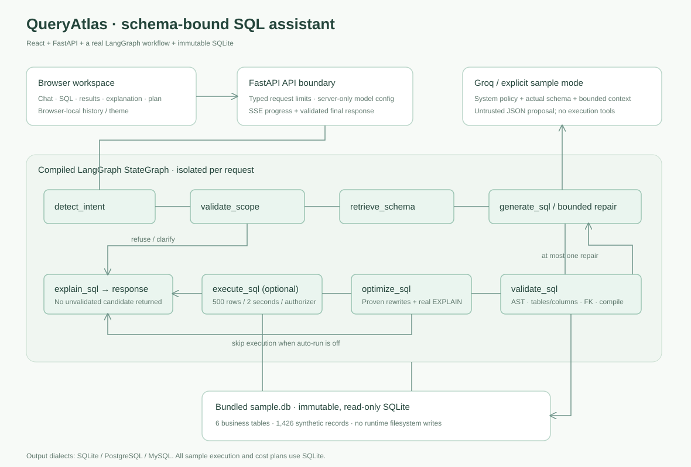

# Application architecture

Design contract: [architecture specification](../specs/02-design.md), [agent specification](../specs/08-agent-and-prompts.md) and [approved amendments](../specs/05-amendments.md).

[Open the standalone diagram](architecture.svg) · [Mermaid diagram source](architecture.mmd)

## Components and ownership

| Component | Implementation | Responsibility |
| --- | --- | --- |
| Browser workspace | [App.tsx](../src/App.tsx), [lib.ts](../src/lib.ts), [types.ts](../src/types.ts) | Chat, query panels, internal scrolling, theme, local history, SSE consumption and actual SQL/CSV exports |
| HTTP boundary | [api/index.py](../api/index.py) | Typed requests, body bounds, schema/health, JSON/SSE chat, independently validated execution and static frontend serving |
| Orchestration | [backend/agent.py](../backend/agent.py) | Compiled LangGraph, isolated per-request state, conditional refusal/clarification routes and one bounded SQL repair |
| Model proposal | [backend/provider.py](../backend/provider.py), [backend/sample.py](../backend/sample.py) | Server-side Groq request or explicitly limited keyless examples; neither can authorize execution |
| SQL safety and optimization | [backend/sql.py](../backend/sql.py) | Parse, qualify actual tables/columns, verify FK joins, allowlist functions, compile, prove safe rewrites and derive explanation |
| Relational storage | [backend/database.py](../backend/database.py), [sample.db](../data/sample.db) | Trusted schema introspection, immutable read-only connections, SQLite authorizer, execution bounds and actual EXPLAIN |
| Runtime prompt policy | [system.txt](../prompts/system.txt), [repair.txt](../prompts/repair.txt) | Versioned exact instructions, loaded by the provider at request time |

## Request and trust boundaries

The browser sends a question plus bounded history to `/api/chat/stream`. FastAPI checks the request before invoking LangGraph. Scope validation and trusted schema retrieval precede any model proposal. The independent validator treats generated, repaired, pasted and historical SQL as untrusted. Only accepted SQL reaches optimization and optional execution. The response contains the accepted SQL, explanation, checks, real plan and optional rows; rejected candidates are not streamed.

The separate `/api/execute` endpoint repeats validation; a browser cannot grant execution by claiming its SQL was previously checked. SQLite also enforces read-only access through URI mode and an authorizer. Runtime SQL cannot write data, inspect system tables or use file/network functions.

Conversation history and theme are bounded browser-local data. The backend has no shared conversation memory or user-data checkpointer, so server replacement does not mix conversations. Prior SQL carries its source dialect and is revalidated before follow-up use. Model credentials exist only in server `.env` or environment variables; the browser has no credential settings.

## Storage and execution semantics

The bundled database contains six related tables and 1,426 synthetic records. It is generated before deployment and opened with `mode=ro&immutable=1`; there are no runtime database writes. Results are capped at 500 rows with an explicit truncation flag and a deadline/instruction budget. Query estimates are coarse interpretations of actual SQLite EXPLAIN plans, not production latency or monetary costs.

The simplified UI uses SQLite. The API additionally supports PostgreSQL/MySQL output, validated and translated for SQLite sample execution. It does not claim native execution on those engines. See [schema/metrics](database.md) and [security boundaries](security.md).

## Local and deployment topology

Locally, one FastAPI process serves the built React application and `/api` on port 8000. During frontend development, Vite proxies `/api` to FastAPI. Browser tests launch a separate keyless process on 8001. The Docker image builds the frontend separately and runs the Python service as a non-root user. Vercel configuration prepares static frontend delivery plus the Python ASGI entrypoint and bundled database/prompt assets. Public publication is deferred under amendment A01.

Detailed node routing, state and model input construction: [workflow.md](workflow.md). Artifact verification: [deliverables.md](deliverables.md) and [verification.md](verification.md).
