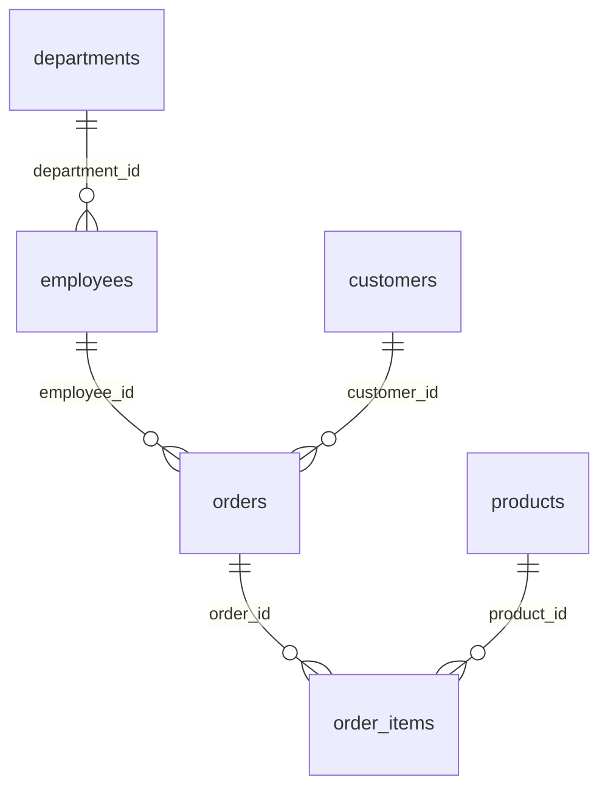

# Sample database and data dictionary

`data/schema.sql` defines the six-table schema; `scripts/seed.py` generates `data/sample.db` deterministically (PRNG seed 20241105). All contacts and transactions are synthetic. The DB contains 4 departments, 24 employees, 120 customers, 18 products, 360 orders and 900 items: 1,426 records total. Seed validates integrity/FKs and ANALYZE statistics before replacing the known sample asset.

| Table | Fields / interpretation |
| --- | --- |
| departments | id PK; name unique team name |
| employees | id PK; name; unique email; department_id FK; hire_date ISO date; salary positive annual USD |
| customers | id PK; name; unique email; city; state full US name; created_at ISO date |
| products | id PK; name; category; price current USD amount |
| orders | id PK; customer_id FK; employee_id FK; order_date ISO date; status completed/processing/cancelled |
| order_items | id PK; order_id FK; product_id FK; positive quantity; unit_price historical USD price |

Every column is required other than SQLite's implicit PK nullability semantics; FK parent ids are integer primary keys. Valid join relationships are precisely the five diagram edges. Unrelated `id=id` joins are not accepted. Name is intentionally repeated across tables, exercising ambiguous-column checks. Emails use example domains.

Indexes: customers.state; employees.hire_date/department_id; orders.customer_id/employee_id/order_date; order_items.order_id/product_id; PK and unique indexes. Trusted introspection reports actual keys/indexes/counts; user SQL cannot query system metadata.

Revenue = SUM(order_items.quantity × order_items.unit_price), excluding cancelled orders; processing counts unless specifically restricted. Use historical unit_price, not current products.price. Order/item dates cover 2024–2025; customer/employee dates also include 2023. The employee example in [specification 09](../specs/09-sql-generation-and-dialects.md) uses >=2024-01-01. Currency is synthetic USD and REAL is for demo arithmetic; use fixed decimals/minor units for a future accounting system.

Runtime connections are `mode=ro&immutable=1` resolved relative to backend source. No API seeds or mutates data. All sample execution and plans are SQLite even when output SQL is rendered as PostgreSQL/MySQL. Build a different database only through the trusted seed; restart the server after replacement to reset immutable assumptions/schema cache.
